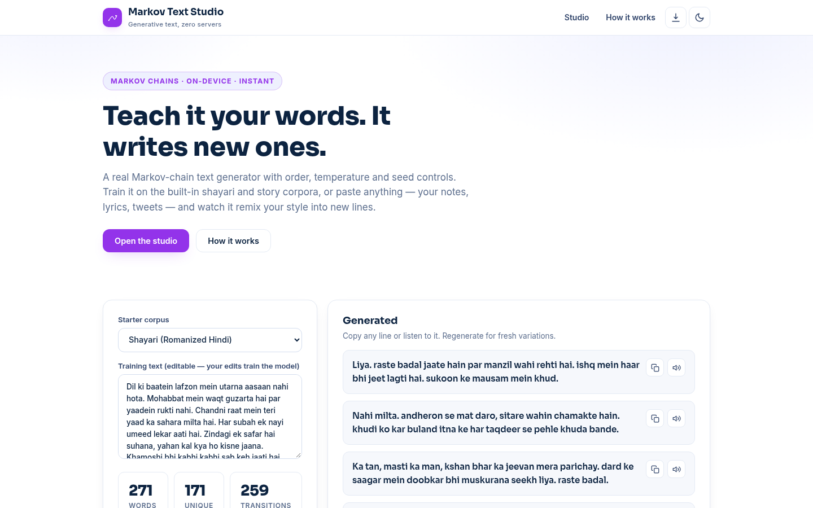
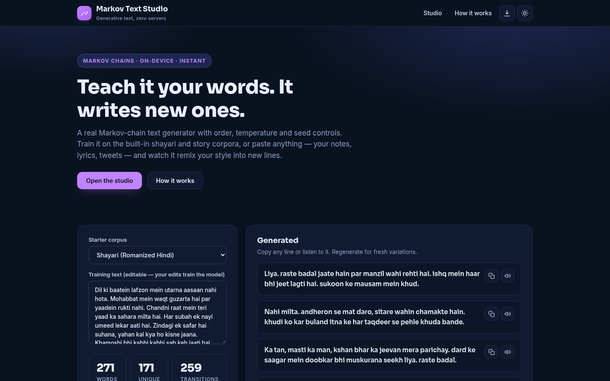
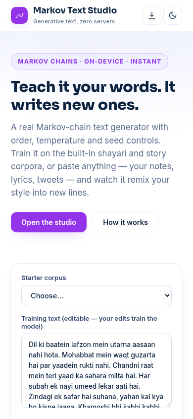

# Markov Text Studio — Train & Generate Text in Your Browser

**Live:** https://akash991833.github.io/markov-text-studio/

A real Markov-chain text generator with order, temperature and seed-word controls. Train it on the built-in shayari, story-starter and tech-wisdom corpora — or paste your own text and remix your own style. Everything runs in your browser and persists offline.

## Features

- **Three starter corpora** — Romanized Hindi shayari, English story starters, tech & startup one-liners
- **Train on anything** — the training text is fully editable; every keystroke rebuilds the model and your version is saved locally
- **Chain order 1–3** — from wild word salad to near-source-faithful
- **Temperature control** — sharpen or flatten the sampling distribution
- **Seed words** — force the generation to start from your phrase
- **Live model stats** — word count, vocabulary size, transition table size
- **Copy & speak** — one-tap clipboard copy and text-to-speech (Hindi/English) per line
- **Dark + light mode**, installable PWA, responsive desktop + mobile

 

## How it works

The text is split into overlapping word sequences of length N. The model remembers which words followed each sequence, then generates by repeatedly sampling the next word and sliding the window. Higher order follows the source more closely; temperature reshapes the sampling odds.

## Honest limits

Markov chains remix patterns — they do not understand meaning. Quality grows with training-text size. A creative toy and teaching tool, not a large language model.

## Tech

Vanilla HTML/CSS/JS. No dependencies, no build step, no server. Free on GitHub Pages.

---

Built by [Akash Vishwakarma](https://github.com/AKASH991833)
